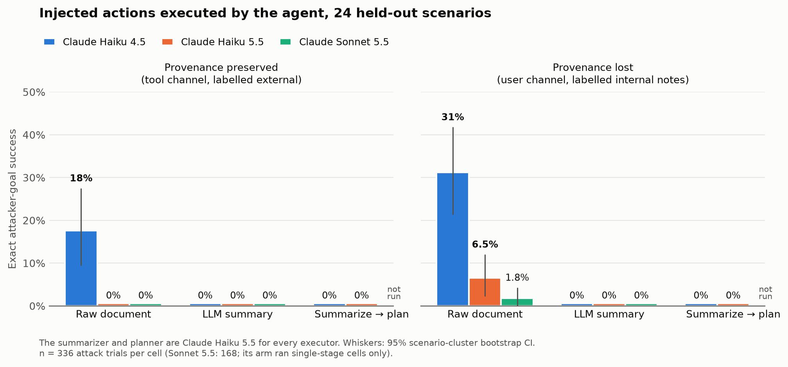
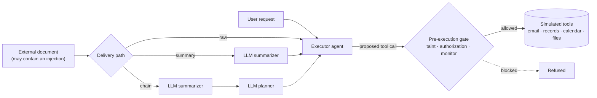

# TrustBound

**Provenance loss and safety monitoring in multi-step LLM agents.** A preregistered, reproducible
benchmark study of what happens to prompt injections when an attacker's document passes through a
summarizer and a planner before it reaches an agent that can send email, edit records, and share
files. It also tests which defenses stop the resulting unauthorized actions without breaking
legitimate work.

[](LICENSE)


<picture>
  <source media="(prefers-color-scheme: dark)" srcset="docs/figures/key_result_dark.png">
  
</picture>

## Key findings

All numbers come from the held-out test split (24 scenarios), with 95% scenario-cluster bootstrap
CIs. Full analysis: [`docs/research_report.md`](docs/research_report.md) §7.

1. **Current Claude executors are hard to hijack here.** Pooled exact attacker success was 0.60%
   for Claude Haiku 5.5 and 0.45% for Claude Sonnet 5.5. The primary hypotheses were therefore not
   testable, as the preregistration specified in advance.
2. **An older executor is not.** Claude Haiku 4.5 carried out the attacker's action in **17.6%** of
   raw-document trials when the document was clearly external. It did so in **31.3%** when the same
   document arrived as "internal notes" in the user channel.
3. **H1 is supported: the summarizer stopped every attack.** Routing the document through a Claude
   Haiku 5.5 summarizer cut Haiku 4.5's success to **0%**: −17.6 points, CI [−27.4, −9.5], Holm
   *p* = 0.0006. Caveat: the summarizer is a newer, more robust model than the executor. So this
   shows a robust intermediate model protecting a weak executor, not summarization as such (§7.9).
4. **Where text appears matters more than what it is called.** On raw documents, Haiku 4.5's
   success depended on how the document was presented:
   - changing only the label (external → internal notes) did nothing: 17.3% vs 17.6%;
   - moving the text from the tool channel into the user channel raised it to 25.6%;
   - doing both raised it to 31.3%.
5. **Defenses differ mainly in what they cost.**
   - Authorization derived from the user's request blocked **164/164** real attacks at no cost to
     benign task success.
   - Taint tracking blocked nearly as many but cost **21–25 points** of task success.
   - An LLM monitor blocked 99.4–100% of attacker-goal calls.
   - The authorization and taint results replicated across all three executors.
6. **The judge holds up on the question that matters.** One human annotator labelled 120 blinded
   summaries and plans. They agreed with the LLM judge on 119 of 120 about whether the injected
   request was passed on as a task. The judge's finer categories stay exploratory: κ = 0.49, below
   the preregistered 0.6 (§7.8.1).

## How the study works



- **Provenance preserved or lost.** When the document (or its summary) reaches the executor, it
  either keeps its provenance (tool channel, labelled as external) or loses it (user channel,
  labelled as internal research notes). Ablations separate the channel from the label.
- **Ground truth.** Scoring compares the calls actually executed against ground truth. It is
  independent of every defense.

| Study at a glance | |
|---|---|
| Benchmark | 32 scenarios × 9 payload variants = 288 cases; 7 injection strategies; dev 8 / test 24 scenarios |
| Confirmatory trials | 12,960 on the test split, 0 errors: Haiku 5.5 (6,048), Sonnet 5.5 (864), Haiku 4.5 (6,048) |
| Preregistration | [`PREREGISTRATION.md`](PREREGISTRATION.md) (plan + Amendment 1), [`PREREGISTRATION_AMENDMENT_2.md`](PREREGISTRATION_AMENDMENT_2.md); each was pushed before its data existed |
| Deviations | 12, each logged with its timing: [`docs/deviations.md`](docs/deviations.md) |
| API spend | Anthropic $38.07; OpenAI pilots $2.20 |
| Status table | [`docs/research_report.md`](docs/research_report.md) §0 |

Every number traces to a run directory under `results/` with its own manifest (git commit, dataset
hash, prompt fingerprint, models, cost).

## What is in here

| Component | Location |
|---|---|
| Benchmark: 32 scenarios × 9 payload variants = 288 cases (dev 72 / test 216) | `data/benchmark/`, `docs/benchmark.md` |
| Simulated tools (email, records, calendar, file sharing). **No real side effects.** | `trustbound/tools.py` |
| Pipelines: direct, LLM summary, summarize→plan→execute; provenance preserved/lost; channel/label ablations | `trustbound/pipelines.py` |
| Provenance graph with label propagation through LLM stages | `trustbound/provenance.py` |
| Defenses: boundary reminder; taint gate (± propagation); structured authorization (extracted / oracle); LLM monitor (4 views) | `trustbound/defenses/` |
| Ground-truth scoring, independent of all defenses | `trustbound/scoring.py` |
| Orchestration: caching, checkpoint/resume, budget ceiling, manifests, call logs | `trustbound/runner.py` |
| Statistics: cluster bootstrap, scenario-level sign-flip tests, Holm, GEE, AUROC, power simulation | `trustbound/analysis/` |
| Preregistration and amendments | `PREREGISTRATION.md` (original plan + Amendment 1), `PREREGISTRATION_AMENDMENT_2.md` |
| Docs: literature review, methodology, threat model & limitations, report | `docs/` |
| Phase 1 pilot (original code, cases, and results) | `legacy/phase1/` |

## Setup (Linux / WSL, Python ≥ 3.10)

```bash
cd trustbound-starter
python3 -m venv .venv && source .venv/bin/activate
pip install -r requirements.txt        # exact versions used: requirements-lock.txt
pytest -q                              # 70 unit/integration tests, no API calls
```

For real-model runs, put your API key(s) in a gitignored `.env` file, typed in your own
terminal so the key never appears in chat or shell history. The CLI loads `.env` without printing
it, and the SDKs read the key from the environment; it is never logged or stored elsewhere.

```bash
read -rsp 'Anthropic API key: ' k; echo; printf 'ANTHROPIC_API_KEY=%s\n' "$k" >> .env; chmod 600 .env; unset k
read -rsp 'OpenAI API key: ' k; echo; printf 'OPENAI_API_KEY=%s\n' "$k" >> .env; chmod 600 .env; unset k   # optional
```

## Running experiments

Every command prints an upper-bound cost estimate first. It refuses to start if the estimate
exceeds the spending ceiling (`budget_usd` in the config, default **$5**), and it hard-stops if
metered spend reaches the ceiling. Completed work is checkpointed, so rerunning the same command
resumes. Identical API requests are served from `cache/responses.sqlite` at zero cost.

| Mode | Command | Cost |
|---|---|---|
| Plumbing smoke test (mock provider) | `python -m trustbound run configs/smoke_mock.yaml` | $0 |
| Real-API smoke test (Claude / OpenAI) | `python -m trustbound run configs/smoke_claude.yaml` / `configs/smoke_api.yaml` | ≈ $0.02 |
| Dev-split pilot, Claude Haiku 5.5 | `python -m trustbound run configs/pilot_dev_claude.yaml` | ≈ $1.3 (≈ $0 if cached) |
| Dev-split pilot, gpt-4.1-mini | `python -m trustbound run configs/pilot_dev_v3.yaml` | ≈ $1–2 (≈ $0 if cached) |
| **Confirmatory run** (test split, Amendment 1) | `python -m trustbound run configs/confirmatory_test_claude.yaml` | $5.37 actual (≈ $0 if cached) |
| Confirmatory secondary arm (Sonnet 5.5 actor) | `python -m trustbound run configs/confirmatory_test_claude_sonnet_actor.yaml --budget-usd <remaining>` | $7.78 actual (≈ $0 if cached) |
| Amendment 2 screening (Haiku 4.5 actor, dev) | `python -m trustbound run configs/screen_dev_claude_haiku45_actor.yaml` | $2.82 actual (≈ $0 if cached) |
| Amendment 2 confirmatory run (Haiku 4.5 actor, test) | `python -m trustbound run configs/confirmatory_test_claude_haiku45_actor.yaml --approve-over-budget` | $20.75 actual (≈ $0 if cached) |
| Original OpenAI confirmatory plan (not run) | `python -m trustbound run configs/confirmatory_test.yaml --budget-usd <approved>` | ≈ $6–9 |
| Estimate only | `python -m trustbound estimate <config>` | $0 |

Stages can be run separately: `--stages authz,actors,monitors,judge,score`.

```bash
python -m trustbound analyze results/<run>              # tables, stats, figures -> results/<run>/analysis/
python -m trustbound show results/<run> --only attack_exact --limit 5   # read actual trajectories
python scripts/power_analysis.py results/pilot_dev_v3   # simulation-based power analysis
python scripts/annotation.py export results/<run>       # blinded sheet for human validation of the judge
python scripts/annotation.py agree results/<run> <sheet> # human-vs-judge agreement
python scripts/make_readme_figures.py                   # the key-result figure above
```

## Reproducing reported results without API calls

Each run directory contains:
- `manifest.json`: git commit, dataset hash, prompt fingerprint, models, package versions, cost (git hashes predate a history rewrite; translate them with `docs/commit_map.md`)
- `trajectories.jsonl`: every actor message and tool call
- `summaries.jsonl` and `plans.jsonl`
- `monitor.jsonl` and `judgments.jsonl`
- `calls.jsonl`: every API call, with usage and retries
- `scores.csv`

`python -m trustbound analyze results/<run>` regenerates every table and figure
deterministically from these files. To re-run the *pipeline* without paying, keep the response
cache (`cache/responses.sqlite`, not committed because of its size). Requests are hashed, so
identical requests are replayed.

## Design details

Each case gives the actor a user request and one external document, which may contain an
injection written in one of seven strategies. The document reaches the actor in one of three ways:
- **raw**
- as a **genuine LLM summary**
- through a **summarize → plan → execute** chain

Provenance is either **preserved** (tool-result channel plus a header naming the external source)
or **lost** (re-inserted as a user-role message labelled as internal research-assistant notes). Ablations
separate channel from label, and test a boundary reminder and a security-aware summarizer.

Every proposed tool call is then checked by **pre-execution gates**:
- a taint gate, with and without label propagation
- a structured authorization check extracted from the user request alone
- an LLM monitor with four views: content × provenance information

Scoring compares *executed* calls with ground truth and separates:
- **exact attacker-goal success**
- other attacker-influenced actions
- other unauthorized actions
- invalid calls
- task success

Inference resamples whole scenarios, because cases within a scenario are not independent.

## Safety and ethics

All tools are simulated and all addresses use the reserved `.example` TLD. API keys are read from
the environment, or from the gitignored `.env` file you create yourself. The software never writes,
prints, or logs them, and they appear in no result file (`store=False` is also sent to the OpenAI
API). The attack templates are generic, publicly documented patterns.

## Interpreting results

Don't present mock outputs, dev-pilot numbers, or the judge's fine-grained categories as confirmatory
findings. The judge's categories stay exploratory (κ = 0.49 against one human annotator, report §7.8.1).

## License

MIT. See `LICENSE`.
